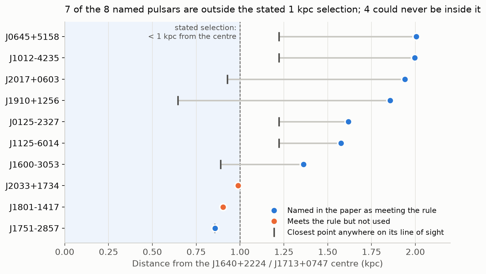

# Pulsar subhalo near the Sun: the stated sample does not match the pulsars used

**[Chakrabarti et al. (2026), PRL 136, 041201](https://doi.org/10.1103/29xz-nt5z) report that pulsar accelerations "identify and constrain the properties of a dark matter sub-halo in the Galaxy for the first time": 2.45×10⁷ M☉, about 0.9 kpc from the Sun. The paper says its solitary pulsars were chosen within 1 kpc of the centre of the pulsar pair J1640+2224 / J1713+0747, and names eight.**

**Seven of the eight are 1.36–2.0 kpc from that centre. Four point away from it and could not be within 1 kpc at any distance.**

The accelerations taken for these pulsars, and the model they are fitted with, have three further problems, listed below. This repository contains the code and saved results; the public catalogue is downloaded from a pinned commit.

## The named pulsars break the stated rule

The paper's text: *"We also select the S/N > 1 solitary pulsars that are near (< 1 kpc) the common center of PSR J1640+2224/PSR J1713+0747. This yields the additional set of solitary pulsars: J0125-2327, J0645+5158, J1012-4235, J1125-6014, J1751-2857, J1910+1256, J2017+0603, J1600-3053."* Table 1 puts the centre at (7.3, 0.57, 0.63) kpc. We placed each pulsar there using the catalogue the paper cites for these accelerations ([Donlon et al. 2025](https://arxiv.org/abs/2501.03409)).

| Pulsar | Distance from the centre | Closest point anywhere on its line of sight |
|---|---:|---:|
| J0645+5158 | 2.01 kpc | 1.22 kpc (the Sun) |
| J1012−4235 | 2.00 kpc | 1.22 kpc (the Sun) |
| J2017+0603 | 1.94 kpc | 0.93 kpc |
| J1910+1256 | 1.86 kpc | 0.65 kpc |
| J0125−2327 | 1.62 kpc | 1.22 kpc (the Sun) |
| J1125−6014 | 1.58 kpc | 1.22 kpc (the Sun) |
| J1600−3053 | 1.36 kpc | 0.89 kpc |
| J1751−2857 | **0.86 kpc** | 0.86 kpc |

The Sun itself is 1.22 kpc from the centre. Four sightlines point away from it, so no distance error can bring those pulsars inside 1 kpc. The result is the same for any solar radius from 7.9 to 8.4 kpc and solar height ±30 pc. Applying the written rule to the same catalogue selects J1751−2857, **J1801−1417** and **J2033+1734**, besides the reference pair. All eight named pulsars lie within 2.01 kpc, which fits a larger radius of about 2 kpc; the paper does not say so.



## Three problems with the inputs and the model

**1. The solitary-pulsar accelerations respond weakly, or backwards, to gravity.** The catalogue infers each pulsar's acceleration from its spin-down, after subtracting a magnetic-braking term estimated from the same spin-down. A real extra acceleration therefore moves the catalogue value by a factor R = 1 − mγ²P/(2B), not by 1:

| | J0125 | J0645 | J1012 | J1125 | J1751 | J1910 | J2017 | J1600 |
|---|---:|---:|---:|---:|---:|---:|---:|---:|
| Response R | 0.46 | **−0.52** | 0.33 | **−0.04** | 0.43 | 0.25 | 0.43 | 0.39 |

The paper treats these values as accelerations with an added scatter term. A subhalo's pull would reach them at 25–46% strength, not at all (J1125), or with the wrong sign (J0645, the most precise of the eight).

**2. The catalogue's magnetic fields do not match its own inputs.** In v1 of the catalogue, every printed field B can be recomputed from that row's spin period, spin-down and proper-motion correction. In v3, 23 of 52 cannot: the correction was updated but B was not. Three named pulsars are affected. Recomputing only the braking term with the row's own inputs:

| Pulsar | Published acceleration | With a consistent B | Change |
|---|---:|---:|---:|
| J1125−6014 | 9.51 ± 1.53 mm/s/yr | **1.80** | −5.0 error bars |
| J0125−2327 | 8.39 ± 1.27 mm/s/yr | **5.02** | −2.7 error bars |
| J1600−3053 | 2.34 ± 0.64 mm/s/yr | 2.67 | +0.5 error bars |

**3. The model leaves out the subhalo's pull on the Sun.** Timing measures each pulsar's acceleration *relative to the Sun*. Eq. 8 includes the subhalo's pull on each pulsar only. The claimed subhalo would pull the Sun by 0.144 mm/s/yr. Along the J1640+2224 line of sight that is half the pull on the pulsar itself. For six of the eight named solitary pulsars, the pull on the Sun is larger than the pull on the pulsar.

## Limits of the finding

- **This does not show that the subhalo is absent.** The paper states that its constraint requires the binary pair J1640+2224 / J1713+0747, whose orbital accelerations none of the above affects. We have not refitted the model.
- **The fit's actual input list was not released.** Either the text or the fitted sample is wrong; we cannot tell which. We also have not established which catalogue version the fit read.
- **A likelihood can model a non-unit response.** Point 1 shows what the catalogue values mean, not by how much the published posterior changes. Whether the authors' code includes the solar term is unknown; Eq. 8 as printed does not.

## Reproduce the checks

Python standard library only. The first run downloads the catalogue from commit `6cb4e31` and checks its SHA-256:

```bash
python3 scripts/check_selection.py   # positions, stated rule, frame scan, solar term
python3 scripts/check_inputs.py      # magnetic-field consistency (v1, v3) and gravity response R
python3 scripts/verify.py            # file checksums, reruns both and compares with results/
```

Redraw the figure with `pip install -r requirements.txt` and `python3 scripts/plot_selection.py`.

[Methods and limitations](docs/METHODS_AND_LIMITATIONS.md) · [Evidence guide](docs/EVIDENCE.md) · [Quoted passages](sources/chakrabarti2026_quotes.md) · [Saved results](results/) · [File checksums](SHA256SUMS) · [Provenance](provenance/SOURCES.json) · [Attribution and licensing](THIRD_PARTY_NOTICES.md)

Independent, AI-assisted audit dated 3 November 2026, examining the accepted [arXiv:2507.16932v3](https://arxiv.org/abs/2507.16932v3); the final typeset PRL text was not accessed. This is not an author-issued correction.
